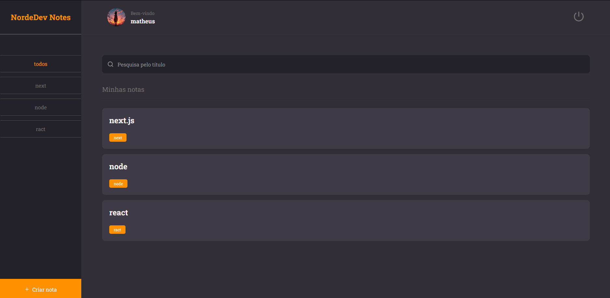

# Nordev Notes

O Nordev Notes é uma aplicação web completa para gerenciamento de notas, construída com tecnologias de desenvolvimento front-end. Este projeto foi desenvolvido como parte de um estudo de caso para demonstrar a implementação de uma aplicação full-stack com React e Node.js.

## Screenshots



## Funcionalidades Detalhadas

- **Autenticação de Usuário:**
  - **Cadastro:** Novos usuários podem se cadastrar fornecendo nome, email e senha.
  - **Login:** Usuários existentes podem acessar suas contas de forma segura.
  - **Perfil:** Os usuários podem visualizar e atualizar suas informações de perfil, incluindo avatar.

- **Gerenciamento de Notas:**
  - **Criação:** Crie novas notas com título, descrição e tags.
  - **Edição:** Edite o conteúdo de notas existentes.
  - **Exclusão:** Remova notas que não são mais necessárias.
  - **Visualização:** Visualize os detalhes de cada nota individualmente.

- **Busca e Filtragem:**
  - **Busca por Título:** Encontre notas rapidamente pesquisando por palavras-chave no título.
  - **Filtragem por Tags:** Filtre as notas por tags específicas para organizar e encontrar informações relevantes.

## Tecnologias Utilizadas

- **React:** Utilizado para construir uma interface de usuário reativa e componentizada.
- **Vite:** Ferramenta de build moderna que proporciona um ambiente de desenvolvimento rápido e otimizado.
- **TypeScript:** Garante um código mais robusto e seguro através da tipagem estática.
- **Styled Components:** Permite a criação de componentes estilizados de forma isolada e reutilizável, facilitando a manutenção do design system.
- **React Router Dom:** Gerencia a navegação entre as diferentes páginas da aplicação de forma declarativa.
- **Axios:** Cliente HTTP para realizar a comunicação com a API do back-end de forma simples e eficiente.
- **ESLint:** Ferramenta de linting para manter a qualidade e a consistência do código.

## Como Executar o Projeto

Para executar o projeto em seu ambiente local, siga os passos abaixo:

1. **Clone o repositório:**
   ```bash
   git clone https://github.com/seu-usuario/nordev-notes.git
   cd nordev-notes
   ```

2. **Instale as dependências:**
   ```bash
   npm install
   ```

3. **Configure a API:**
   Certifique-se de que o back-end da aplicação está em execução e configure a URL da API no arquivo `src/services/api.ts`.

4. **Execute a aplicação:**
   ```bash
   npm run dev
   ```

   A aplicação estará disponível em `http://localhost:5173`.

## Estrutura do Projeto

A estrutura de pastas do projeto foi organizada da seguinte forma para garantir a escalabilidade e a manutenibilidade da aplicação:

```
norddev-notes/
├── src/
│   ├── assets/         # Imagens, ícones e outros arquivos estáticos
│   ├── components/     # Componentes reutilizáveis (Botões, Inputs, etc.)
│   ├── hooks/          # Hooks personalizados (ex: useAuth)
│   ├── pages/          # Páginas da aplicação (Home, SignIn, Profile, etc.)
│   ├── routes/         # Configuração das rotas (Auth, App)
│   ├── services/       # Comunicação com a API (Axios)
│   └── styles/         # Estilos globais e tema da aplicação
├── .eslintrc.cjs       # Configurações do ESLint
├── .gitignore          # Arquivos e pastas ignorados pelo Git
├── index.html          # Arquivo HTML principal da aplicação
├── package.json        # Lista de dependências e scripts do projeto
├── README.md           # Documentação do projeto
└── vite.config.ts      # Configurações do Vite
```

